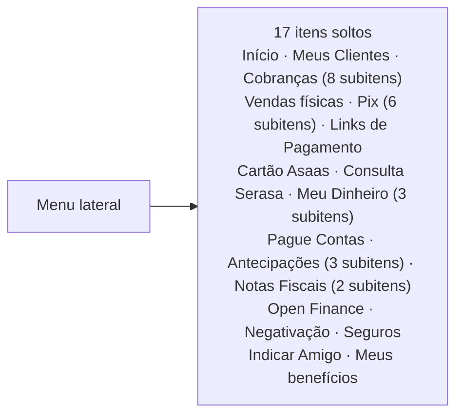
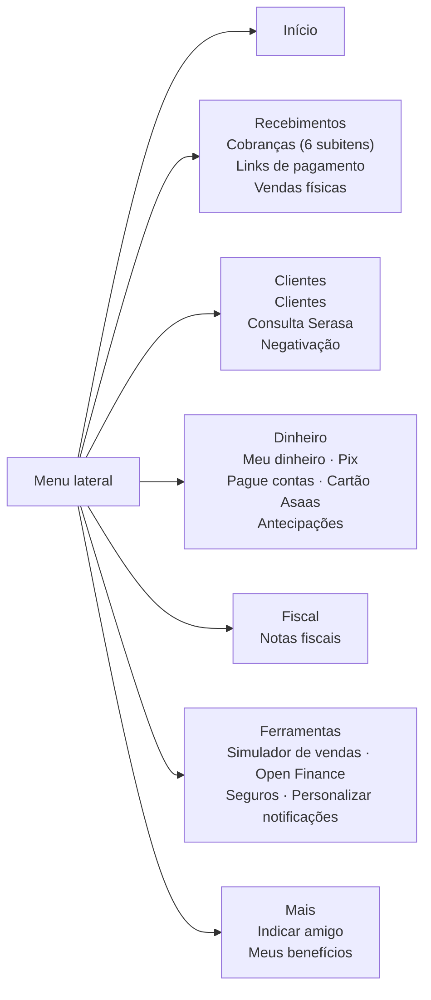
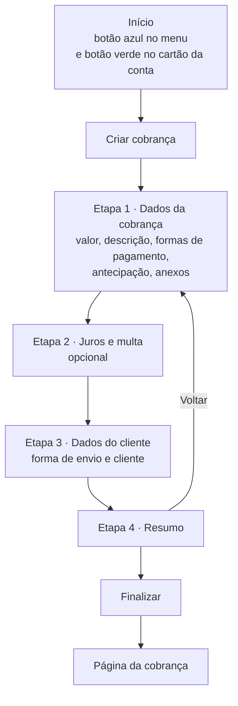
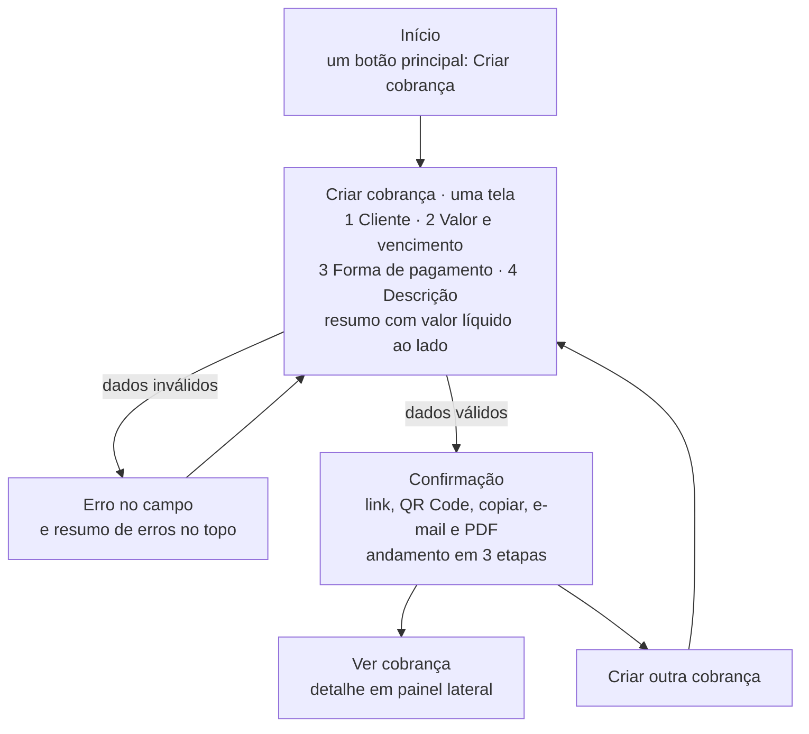
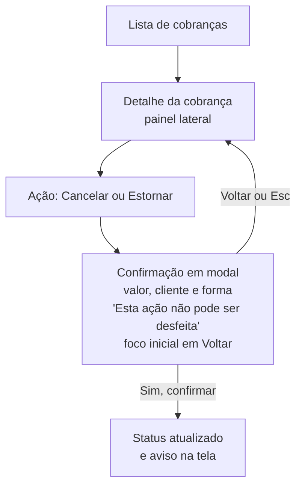
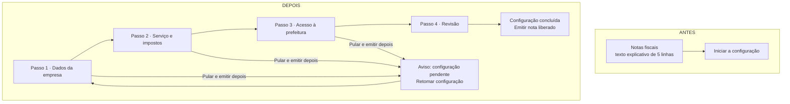
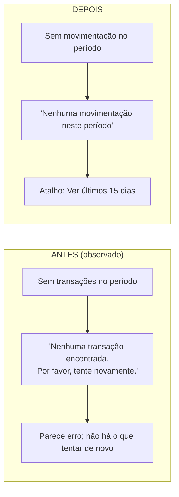
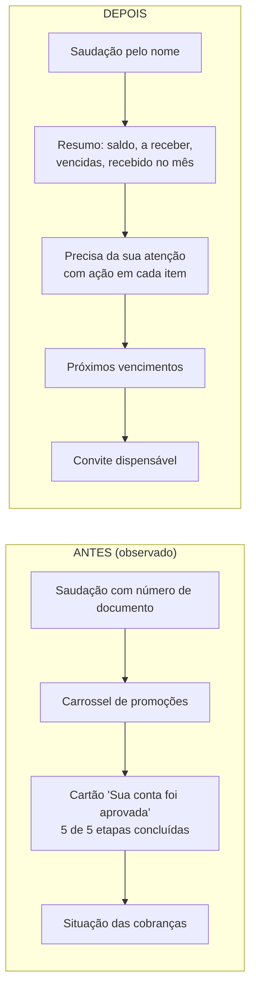

# 5 · Jornadas: antes e depois

Os fluxogramas abaixo usam Mermaid e aparecem desenhados no GitHub. O **"antes"** vem do que foi observado no painel original ou do que a Central de Ajuda do Asaas descreve (marcado em cada caso). O **"depois"** é o protótipo desta pasta.

## 1 · Navegação

**Antes (observado):** 17 itens no primeiro nível, sem agrupamento.

**Depois:** os mesmos recursos, organizados pela tarefa de quem usa. Os dois itens que estavam dentro de Cobranças e não eram cobranças (Simulador de vendas e Personalizar notificações) foram para Ferramentas.

## 2 · Criar a primeira cobrança

**Antes** (Central de Ajuda do Asaas, resumo de busca; o botão "Criar cobrança" aparece em mais de um lugar, observado):

**Depois** (protótipo):

| | Antes | Depois |
|---|---|---|
| Telas ou etapas até criar | Início + 4 etapas + página da cobrança | Início + 1 formulário + confirmação |
| Posição do cliente | 3ª etapa | 1º bloco, com busca e cadastro no campo |
| Campos obrigatórios | Não detalhados na fonte | 3 (cliente, valor e vencimento); +1 (CPF ou CNPJ) se o cliente é novo |
| Valor que a pessoa recebe | Não mencionado na fonte | Visível em tempo real no resumo |
| Botão principal | Mais de um, em cores diferentes | Um por tela |

*Contagem de etapas e telas. Não medimos tempo nem erros; isso depende do [teste com usuários](01-metodo-e-evidencias.md#validação-que-falta).*

## 3 · Ação irreversível (cancelar, estornar, enviar Pix)

O original não foi testado nesse ponto. No redesenho, o fluxo é este, por decisão de projeto (H3 e H5):

## 4 · Notas fiscais

**Antes (observado):** bloco de cinco linhas e um botão. **Depois:** passos curtos, com saída.

## 5 · Estado vazio do Extrato

## 6 · Primeira tela, por prioridade

