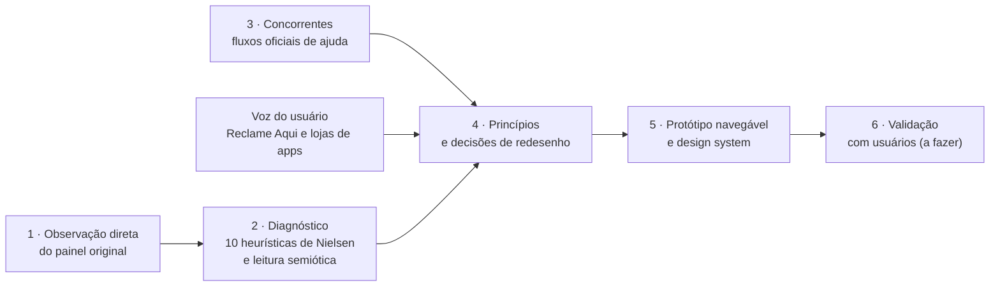

# Estudo de caso · Redesenho do painel do Asaas (conceito)

Este material mostra **como se chegou** ao redesenho, e não só o resultado visual. O caminho foi: observar o painel original, diagnosticar com critérios reconhecidos, comparar com concorrentes, ouvir o que usuários relatam em fontes públicas, definir princípios, prototipar e deixar claro o que ainda falta validar.

> **Isto é uma simulação.** A landing e o painel são um conceito de design: todos os valores, nomes, datas, taxas, estatísticas, contatos e áudios que aparecem neles são **fictícios**. Nada ali é um dado real nem mede um produto em operação. Não é um produto do Asaas e não tem relação oficial com a empresa.
>
> O que **não** é fictício neste estudo são as **fontes públicas** citadas (páginas de ajuda, Reclame Aqui, lojas de aplicativos, normas de acessibilidade), sempre indicadas com a data de consulta. Elas descrevem o mercado de verdade; o protótipo, não.

## Como o trabalho foi feito

## Leia nesta ordem

| # | Documento | O que responde |
|---|---|---|
| 1 | [Método e evidências](01-metodo-e-evidencias.md) | De onde vem cada informação, o que foi lido de fato e o que não foi medido |
| 2 | [Diagnóstico do painel original](02-diagnostico-original.md) | O que encontramos, qual critério isso fere e o que decidimos mudar |
| 3 | [Comparação com concorrentes](03-concorrentes.md) | O que cada um faz bem, onde há limite e o que resolvemos |
| 4 | [Voz do usuário](04-voz-do-usuario.md) | O que usuários relatam publicamente e o que o redesenho não resolve |
| 5 | [Jornadas: antes e depois](05-jornada-antes-depois.md) | Fluxogramas da navegação, da primeira cobrança e do fiscal |
| 6 | [Design system](06-design-system.md) | Tokens, componentes, contraste calculado e regras de acessibilidade |
| 7 | [Visão de futuro](07-visao-de-futuro.md) | O que o produto oferece, o que o mercado oferece e onde há espaço para evoluir |

A versão visual do design system fica em `design-system/index.html` (publicada junto com o site).

## Resumo do que mudou

| Tema | Antes (observado ou documentado) | Depois (protótipo) |
|---|---|---|
| Menu | 17 itens no primeiro nível, sem agrupamento | Grupos por tarefa (Recebimentos, Clientes, Dinheiro, Fiscal, Ferramentas) e rodapé "Mais" |
| Botão principal | Aparece em mais de um lugar na mesma tela, em cores diferentes | Um botão principal por tela, no cabeçalho, no mesmo estilo |
| Início | Promoções e checklist já concluído antes das pendências | Pendências, saldo e vencimentos primeiro; checklist só enquanto incompleto |
| Criar cobrança | 4 etapas em sequência, com o cliente na terceira | Um formulário, cliente primeiro, valor líquido visível, erros no campo |
| Extrato vazio | "Nenhuma transação encontrada. Por favor, tente novamente." | "Nenhuma movimentação neste período", com atalho para ampliar o período |
| Notas fiscais | Texto longo antes do botão de configurar | 4 passos com progresso e opção de pular |

## O que este estudo prova e o que não prova

- **Prova:** que cada decisão de design tem um problema observado, um critério e uma evidência por trás.
- **Não prova:** que o resultado é mais rápido ou mais fácil para quem usa. Isso exige teste com pessoas (roteiro em [Método e evidências](01-metodo-e-evidencias.md#validação-que-falta)).
- O painel original foi observado numa **conta recém-aberta e sem movimentação**. As telas com dados (listas, filtros, detalhes) do original não foram vistas.
